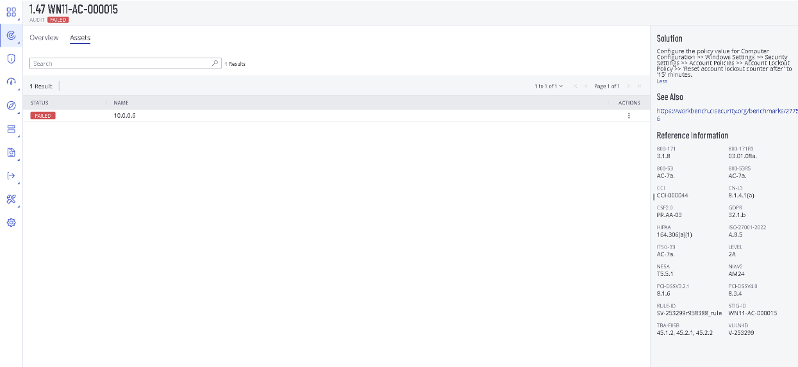

# WN11-AC-000015 — Account Lockout Counter Reset

## Overview

This project demonstrates the identification and remediation of Windows 11 DISA STIG control **WN11-AC-000015 (V-253299)** using PowerShell and Tenable Vulnerability Management.

The security control requires Windows to reset its failed account logon counter after **15 minutes**.

## Security Risk

An improperly configured account lockout policy can increase exposure to password-guessing attacks. Configuring an appropriate observation window helps limit repeated authentication attempts by maintaining a failed-logon count over the required period.

## Lab Environment

| Component | Technology |
|---|---|
| Operating System | Windows 11 VM |
| Compliance Scanner | Tenable Vulnerability Management |
| Automation | Windows PowerShell 5.1 |
| Security Framework | DISA Windows 11 STIG |
| STIG ID | WN11-AC-000015 |
| Vulnerability ID | V-253299 |
| Severity | CAT II |

## Initial Finding

The initial Tenable compliance scan identified WN11-AC-000015 as **FAILED**.

The Windows account lockout observation window was configured to 10 minutes, which did not meet the required 15-minute setting.



## PowerShell Remediation

A PowerShell script was developed to configure the required account lockout policies.

The remediation sets:

- Account lockout duration: 15 minutes
- Reset account lockout counter after: 15 minutes

```powershell
net accounts /lockoutduration:15
net accounts /lockoutwindow:15
net accounts
```

The full script includes administrator privilege validation, error handling, and configuration output.

**[View the PowerShell remediation script](WN11-AC-000015.ps1)**

## Verification and Results

After executing the PowerShell remediation script, the Windows account lockout settings were verified locally.

A subsequent Tenable compliance scan confirmed that WN11-AC-000015 changed from **FAILED** to **PASSED**.


| Check | Before | After |
|---|---|---|
| Lockout duration | 10 minutes | 15 minutes |
| Lockout observation window | 10 minutes | 15 minutes |
| Tenable compliance | FAILED | PASSED |

## Skills Demonstrated

- DISA STIG compliance remediation
- Windows 11 security hardening
- PowerShell scripting and automation
- Windows account security policy configuration
- Tenable vulnerability and compliance scanning
- Remediation validation and technical documentation

## Author

**Heera Verma**

[GitHub](https://github.com/Heera-V) | [LinkedIn](https://www.linkedin.com/in/heera-v)
