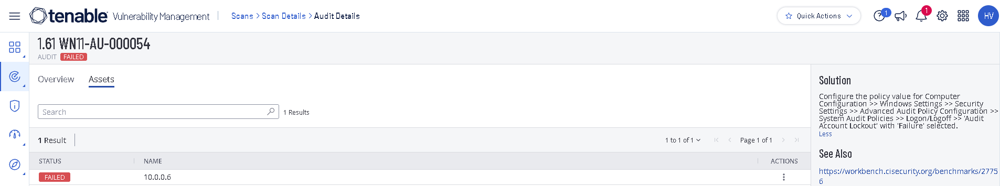
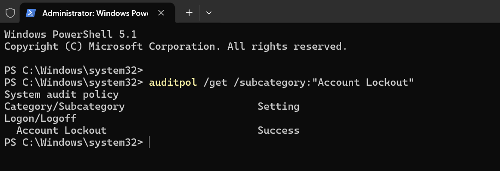
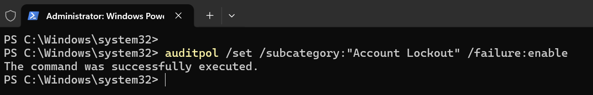
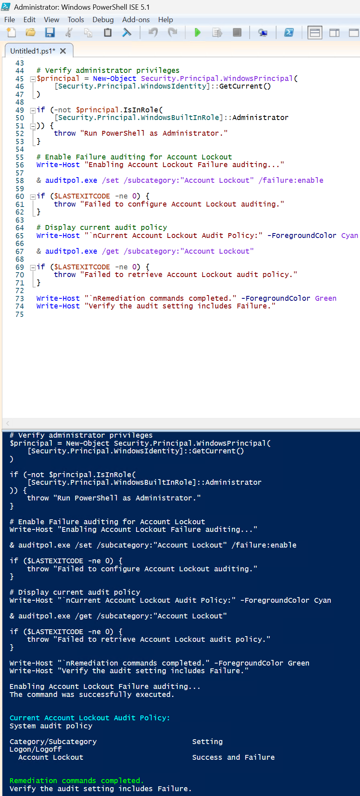
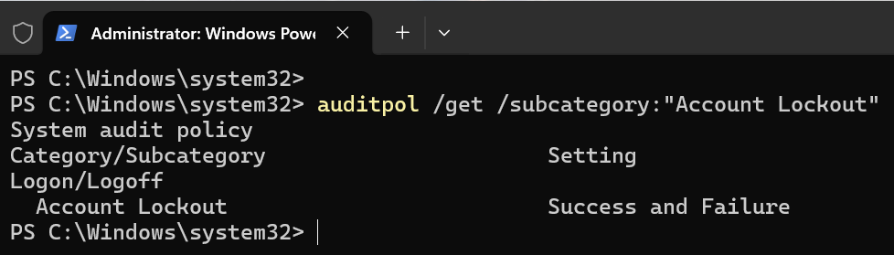
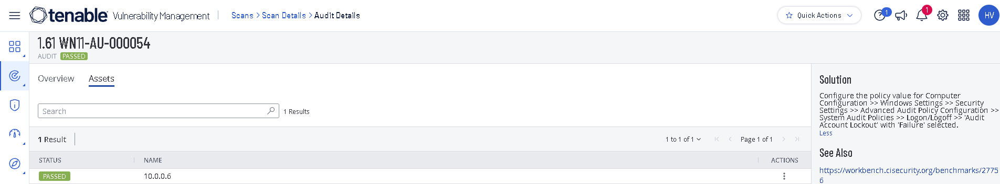

# WN11-AU-000054 — Audit Account Lockout Failures

## Overview

This project demonstrates the identification and remediation of Windows 11 DISA STIG control **WN11-AU-000054** using PowerShell and Tenable Vulnerability Management.

The security control requires Windows to enable **Failure auditing** for the Account Lockout audit subcategory.

The objective is to improve security monitoring by recording failed authentication attempts involving locked accounts.

## Security Risk

Without Account Lockout failure auditing, security teams may have reduced visibility into authentication attempts involving locked accounts.

This can make it more difficult to investigate:

- Password-guessing attacks.
- Unauthorized authentication attempts.
- Repeated attempts to access locked accounts.
- Suspicious authentication activity.

Enabling Failure auditing provides additional security information for incident investigation.

## Lab Environment

| Component | Technology |
|---|---|
| Operating System | Windows 11 VM |
| Compliance Scanner | Tenable Vulnerability Management |
| Automation | Windows PowerShell 5.1 |
| Configuration Tool | auditpol.exe |
| Security Framework | DISA Windows 11 STIG |
| STIG ID | WN11-AU-000054 |
| Tenable Audit ID | 1.61 |
| Severity | CAT II (Medium) |

## Initial Finding

The initial Tenable compliance scan identified **WN11-AU-000054 as FAILED**.

The Windows Account Lockout audit subcategory was configured for Success auditing only.

The DISA STIG requires Failure auditing to be enabled.

### Initial Tenable Scan — FAILED



### Original Windows Audit Configuration

The existing configuration was inspected using:

```powershell
auditpol /get /subcategory:"Account Lockout"
```

The output showed:

```text
Account Lockout                 Success
```

Failure auditing was not enabled.



## Manual Remediation

The required audit configuration was applied using the Windows auditpol utility.

### Remediation Command

```powershell
auditpol /set /subcategory:"Account Lockout" /failure:enable
```

This command enables Failure auditing while preserving the existing Success auditing configuration.

### Manual Remediation Evidence



## PowerShell Automation

A reusable PowerShell remediation script was created to automate the security configuration.

The script performs the following actions:

1. Verifies administrator privileges.
2. Enables Account Lockout Failure auditing.
3. Checks the command exit status.
4. Retrieves the current audit configuration.
5. Displays the remediation results.

### Full PowerShell Script

[View WN11-AU-000054.ps1 — Remediation Script](WN11-AU-000054.ps1)

### Automated Remediation Execution



### Local Verification

The configuration was verified using:

```powershell
auditpol /get /subcategory:"Account Lockout"
```

Expected and observed output:

```text
Category/Subcategory           Setting
Logon/Logoff
  Account Lockout              Success and Failure
```

The required Failure auditing was successfully enabled.



## Verification and Results

Following the initial remediation, another Tenable compliance scan was performed.

Tenable confirmed that **WN11-AU-000054 changed from FAILED to PASSED**.

The saved PowerShell automation script was subsequently executed successfully against the compliant configuration.

### Final Tenable Scan — PASSED



### Before and After Comparison

| Check | Before | After |
|---|---|---|
| Account Lockout Auditing | Success | Success and Failure |
| Failure Auditing | Disabled | Enabled |
| Tenable Compliance | FAILED | PASSED |
| STIG Requirement | Not Met | Met |

**Result:** The Windows 11 VM successfully met the Account Lockout Failure auditing requirement, as verified through Tenable.

## Skills Demonstrated

- DISA STIG compliance remediation
- Windows 11 security hardening
- PowerShell automation and scripting
- Windows Advanced Audit Policy configuration
- Authentication security monitoring
- Tenable compliance scanning
- Remediation verification and troubleshooting
- Technical documentation and evidence collection

## Security Concepts Learned

### Account Lockout Auditing

Account Lockout auditing supports investigation of authentication attempts involving locked user accounts.

### Success vs. Failure Auditing

Success auditing records successful events in an audit subcategory, while Failure auditing records relevant unsuccessful events.

For this STIG, Failure auditing is required.

### Audit Policy Management

The Windows `auditpol.exe` utility allows administrators to inspect and configure Advanced Audit Policy settings.

### Compliance Validation

Successfully executing a PowerShell command does not independently guarantee compliance.

Tenable provides separate verification against the configured security benchmark.

## Author

**Heera Verma**

[GitHub](https://github.com/Heera-V) | [LinkedIn](https://www.linkedin.com/in/heera-v)
