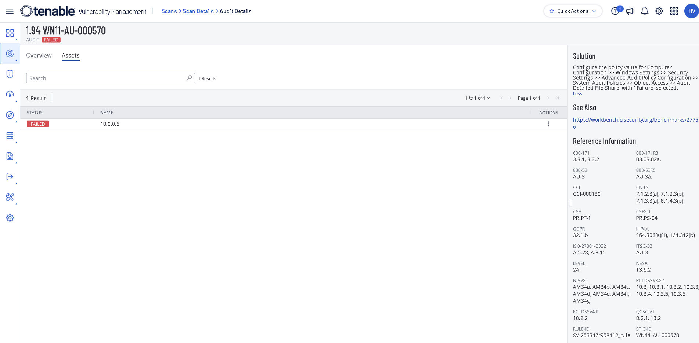
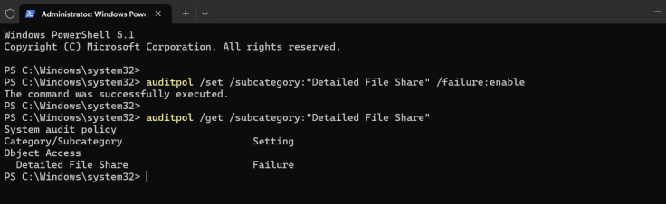
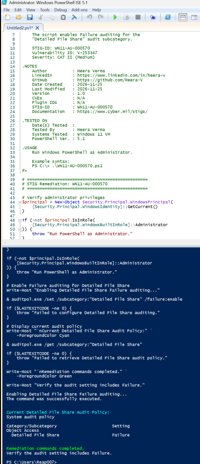
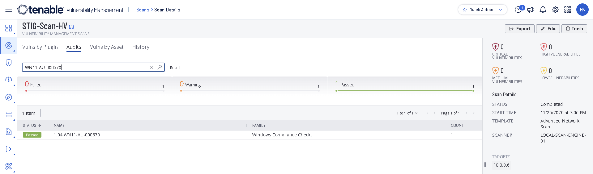

# WN11-AU-000570 — Audit Detailed File Share Failures

## Overview

This project demonstrates the identification and remediation of Windows 11 DISA STIG control **WN11-AU-000570 (V-253347)** using PowerShell automation and Tenable Vulnerability Management.

This security control requires Windows to enable **Failure auditing** for the **Detailed File Share** audit subcategory.

The objective is to improve security monitoring by ensuring unsuccessful network file share access attempts can be recorded in Windows security logs.

## Security Risk

Without Detailed File Share failure auditing, unsuccessful attempts to access network shares may not be recorded.

This reduces visibility into potentially suspicious activities, including:

- Unauthorized attempts to access shared files.
- Failed access attempts against network resources.
- Possible lateral movement or unauthorized file access.
- Repeated access-denied events that may indicate malicious activity.

Enabling failure auditing provides additional information that security analysts can use during incident investigations.

## Lab Environment

| Component | Technology |
|---|---|
| Operating System | Windows 11 VM |
| Compliance Scanner | Tenable Vulnerability Management |
| Automation | Windows PowerShell 5.1 |
| Audit Configuration | Windows Advanced Audit Policy |
| Security Framework | DISA Windows 11 STIG |
| STIG ID | WN11-AU-000570 |
| Vulnerability ID | V-253347 |
| Severity | CAT II (Medium) |

## Initial Finding

An initial Tenable compliance scan identified **WN11-AU-000570** as **FAILED**.

The finding indicated that the required Failure auditing configuration for Detailed File Share was not compliant.

The required policy is located at:

Computer Configuration → Windows Settings → Security Settings → Advanced Audit Policy Configuration → System Audit Policies → Object Access → Audit Detailed File Share

**Initial Tenable Result: FAILED**



## PowerShell Remediation

A PowerShell remediation script was prepared to enable Failure auditing for the Windows Detailed File Share audit subcategory.

Unlike registry-based STIG remediations, this control uses Windows Advanced Audit Policy and the built-in `auditpol.exe` utility.

### Remediation Command

```powershell
auditpol /set /subcategory:"Detailed File Share" /failure:enable
```

This command enables Windows auditing for failed Detailed File Share access attempts.

### Verification Command

```powershell
auditpol /get /subcategory:"Detailed File Share"
```

The expected configuration is:

```text
System audit policy

Category/Subcategory                Setting
Object Access
  Detailed File Share               Failure
```

The full PowerShell script includes:

- Administrator privilege verification.
- Execution of the required audit policy change.
- Error handling using `$LASTEXITCODE`.
- Display of the resulting audit policy.
- Execution messages for troubleshooting.

### Full PowerShell Script

**[View WN11-AU-000570.ps1 — PowerShell Remediation Script](WN11-AU-000570.ps1)**

### PowerShell Script Execution

The following screenshot demonstrates the remediation script executing in Windows PowerShell ISE 5.1.



### Local Configuration Verification

The audit policy was inspected using `auditpol`, confirming that Failure auditing was enabled.



## Verification and Results

Following the audit policy change, another Tenable compliance scan was performed.

Tenable confirmed that **WN11-AU-000570 changed from FAILED to PASSED**.

**Final Tenable Result: PASSED**



### Before and After Comparison

| Check | Before | After |
|---|---|---|
| STIG ID | WN11-AU-000570 | WN11-AU-000570 |
| Detailed File Share Failure Auditing | Noncompliant | Enabled |
| Local Audit Policy Verification | Not recorded | Failure |
| Tenable Compliance Status | FAILED | PASSED |

**Result:** The Windows 11 VM successfully met the Detailed File Share Failure auditing requirement as verified by Tenable.

The saved PowerShell automation script was also executed successfully and confirmed the required local audit setting.

## Skills Demonstrated

- DISA STIG compliance remediation.
- Windows 11 security hardening.
- PowerShell scripting and automation.
- Windows Advanced Audit Policy configuration.
- Windows security event auditing.
- Tenable vulnerability and compliance scanning.
- Remediation validation and troubleshooting.
- Technical documentation and evidence collection.

## Security Concepts Learned

### Windows Advanced Audit Policy

Advanced Audit Policy allows administrators to configure detailed auditing requirements for specific Windows security activities.

### Detailed File Share Auditing

Detailed File Share auditing provides visibility into access attempts involving shared network resources.

### Failure Auditing

Failure auditing records unsuccessful access attempts, supporting security investigations and monitoring.

### Security Compliance Verification

A successful PowerShell command alone does not guarantee compliance.

An authenticated Tenable scan provides independent verification that the audited configuration meets the benchmark requirement.

## Author

**Heera Verma**

[GitHub](https://github.com/Heera-V) | [LinkedIn](https://www.linkedin.com/in/heera-v)
