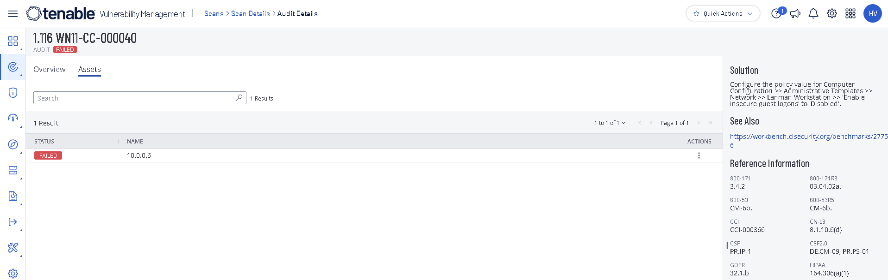
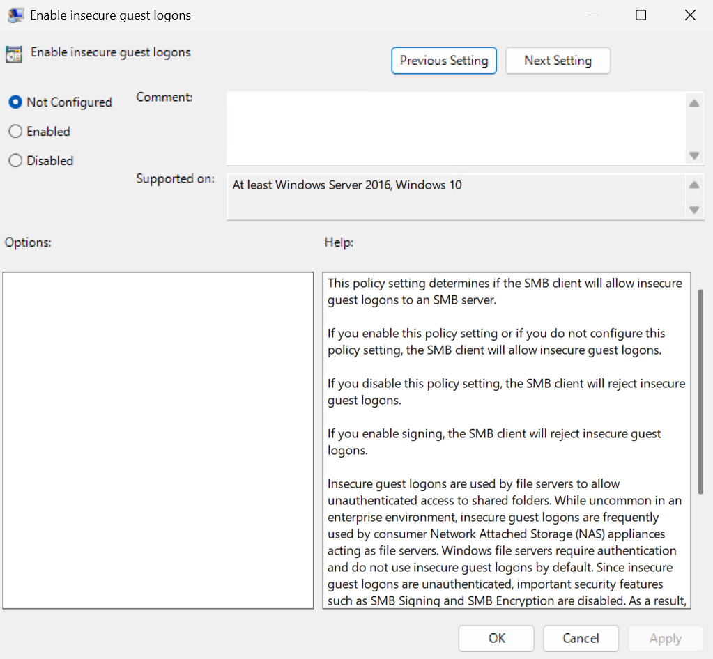
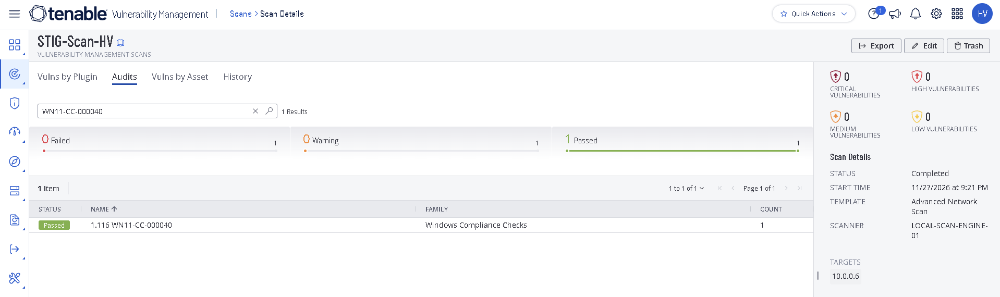
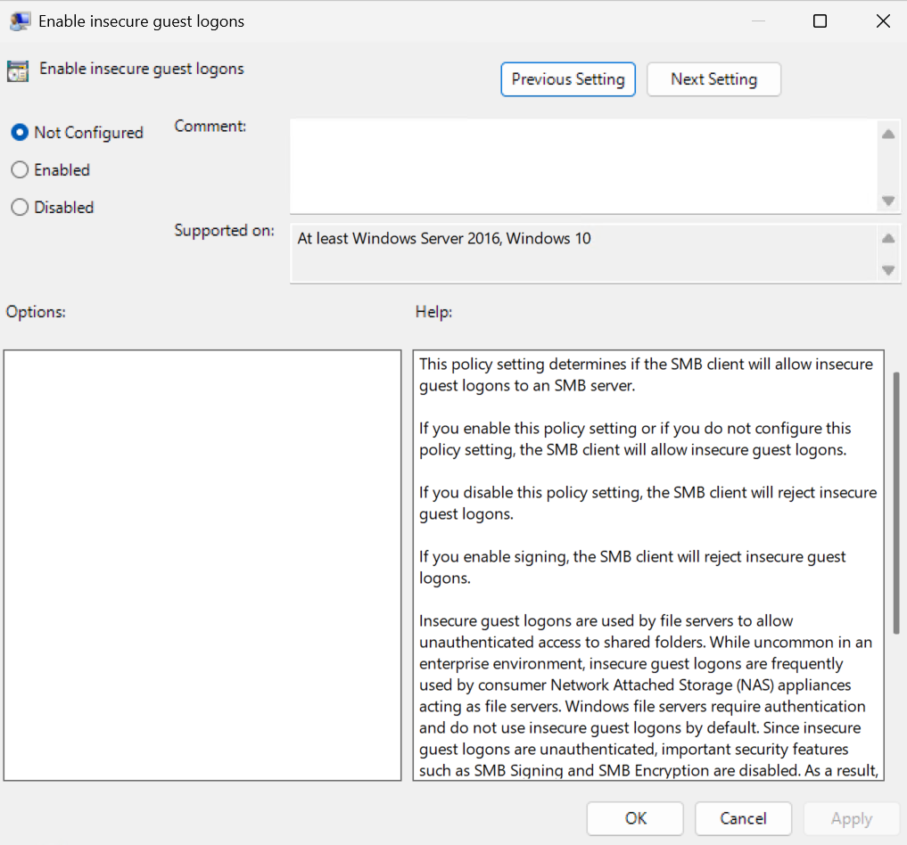
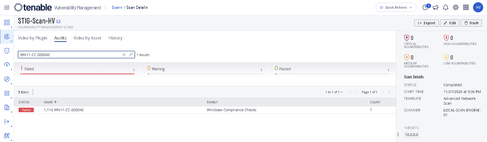
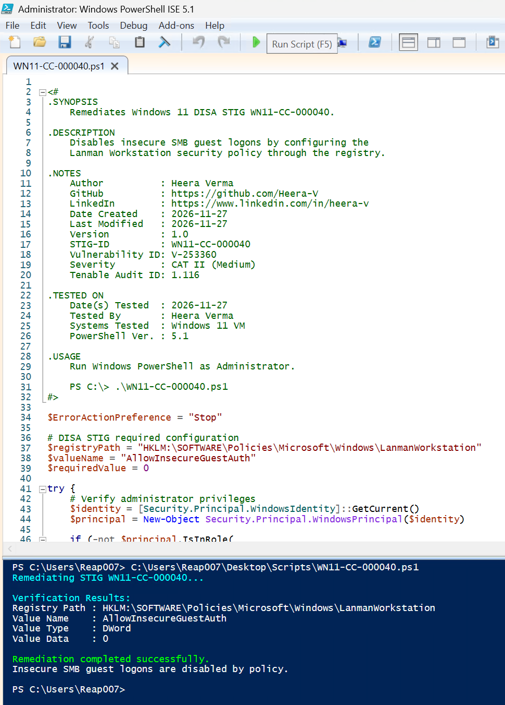
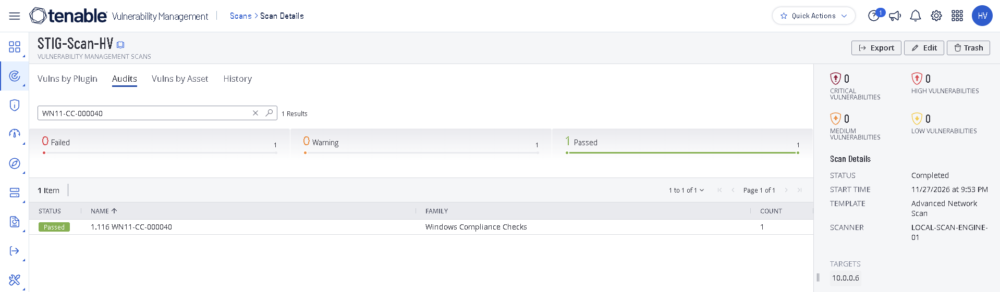

# WN11-CC-000040 — Disable Insecure SMB Guest Logons

## Overview

This project demonstrates identification, manual remediation, rollback validation, and PowerShell automation of Windows 11 DISA STIG **WN11-CC-000040**. This control requires the **Enable insecure guest logons** policy to be **Disabled**, preventing the Windows SMB client from accepting unauthenticated guest sessions.

| Detail | Value |
|---|---|
| STIG ID | **WN11-CC-000040** |
| Vulnerability ID | V-253360 |
| Tenable Audit ID | **1.116** |
| Severity | CAT II (Medium) |
| Target | Windows 11 VM, 10.0.0.6 |
| Policy | Enable insecure guest logons |
| Required state | **Disabled** |
| PowerShell | Windows PowerShell ISE 5.1 |
| Test date | November 27, 2026 |
| Status | **PowerShell remediation successful; final Tenable verification pending** |

## Security Risk

Insecure SMB guest logons allow client access to some network file shares without authenticating a user. Unauthenticated sessions weaken accountability and are not compatible with protections such as SMB signing and encryption in guest sessions. Explicitly disabling insecure guest logons helps protect SMB client connections.

## Initial Finding — FAILED

Tenable Vulnerability Management flagged **1.116 WN11-CC-000040** as **FAILED** during the initial scan.

### Initial Tenable Finding — FAILED



### Original Group Policy — Not Configured

The policy was inspected under:

**Computer Configuration → Administrative Templates → Network → Lanman Workstation → Enable insecure guest logons**

The setting was **Not Configured**. The STIG requires the policy to be explicitly **Disabled**.



## Manual Remediation — PASSED

1. Open Local Group Policy Editor (`gpedit.msc`).
2. Navigate to **Computer Configuration → Administrative Templates → Network → Lanman Workstation**.
3. Open **Enable insecure guest logons**.
4. Select **Disabled**, then **Apply → OK**.
5. Reopen the policy to verify the setting.

### Manual Group Policy — Disabled


### Tenable Verification After Manual Remediation — PASSED

The `STIG-Scan-HV` rescan reported **PASSED** for **WN11-CC-000040** on November 27, 2026, at **9:21 PM**.



## Rollback Testing — FAILED

The Group Policy setting was restored to **Not Configured** to test the independent PowerShell remediation.

### Group Policy Rollback — Not Configured



### Tenable Verification After Rollback — FAILED

The Tenable rescan showed **FAILED** on November 27, 2026, at **9:36 PM**.



## Automated PowerShell Remediation

The Windows PowerShell 5.1 remediation script was executed as Administrator and successfully verified the required registry setting.

**[View WN11-CC-000040.ps1 — Full PowerShell Script](WN11-CC-000040.ps1)**

### Required Registry Configuration

| Registry field | Required value |
|---|---|
| Path | `HKLM\SOFTWARE\Policies\Microsoft\Windows\LanmanWorkstation` |
| Name | `AllowInsecureGuestAuth` |
| Type | `REG_DWORD` |
| Data | `0` (Disabled) |

### Core Remediation Command

```powershell
New-ItemProperty `
    -Path "HKLM:\SOFTWARE\Policies\Microsoft\Windows\LanmanWorkstation" `
    -Name "AllowInsecureGuestAuth" `
    -PropertyType DWord `
    -Value 0 `
    -Force | Out-Null
```

The complete script checks administrator privileges, creates the policy registry key if absent, writes the DWORD, reads back its value and type, and reports success or failure.

### PowerShell Execution — Successful

Output from Windows PowerShell ISE 5.1:

```text
Value Name    : AllowInsecureGuestAuth
Value Type    : DWord
Value Data    : 0

Remediation completed successfully.
Insecure SMB guest logons are disabled by policy.
```



## Final Tenable Verification — PENDING

The PowerShell script verified the required registry configuration. The **final Tenable compliance rescan has not yet been provided**, so the final compliance status remains pending.



### Before and After Results

| Stage | Configuration | Result |
|---|---|---|
| Initial assessment | Not Configured | **Tenable FAILED** |
| Manual remediation | Disabled | **Tenable PASSED** |
| Rollback | Not Configured | **Tenable FAILED** |
| PowerShell remediation | `AllowInsecureGuestAuth = 0` (DWORD) | **Script verified** |
| Final compliance scan | Pending | **Awaiting Tenable verification** |

## Skills Demonstrated

- DISA STIG compliance assessment and Windows 11 hardening
- SMB client authentication security
- Windows Local Group Policy configuration
- Windows Registry policy automation
- PowerShell 5.1 scripting and verification
- Manual remediation and rollback testing
- Tenable Vulnerability Management audits
- Security evidence and GitHub documentation

## Author

**Heera Verma** — [GitHub](https://github.com/Heera-V) · [LinkedIn](https://www.linkedin.com/in/heera-v)
