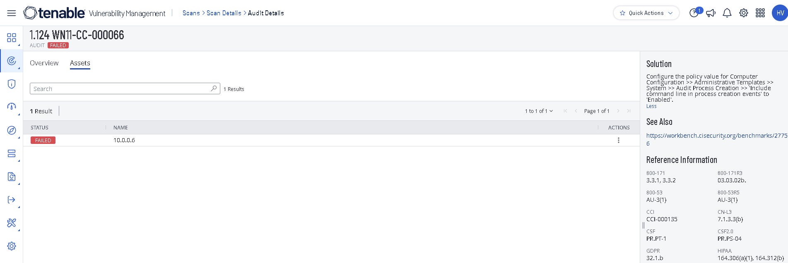
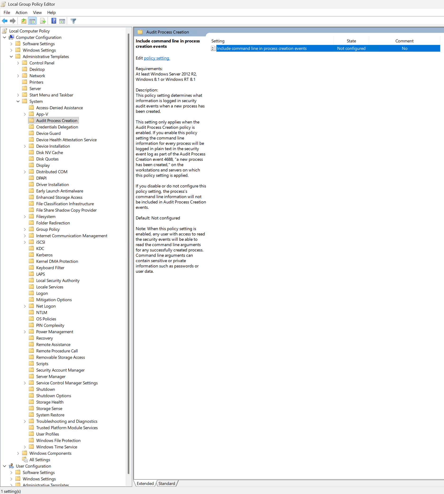
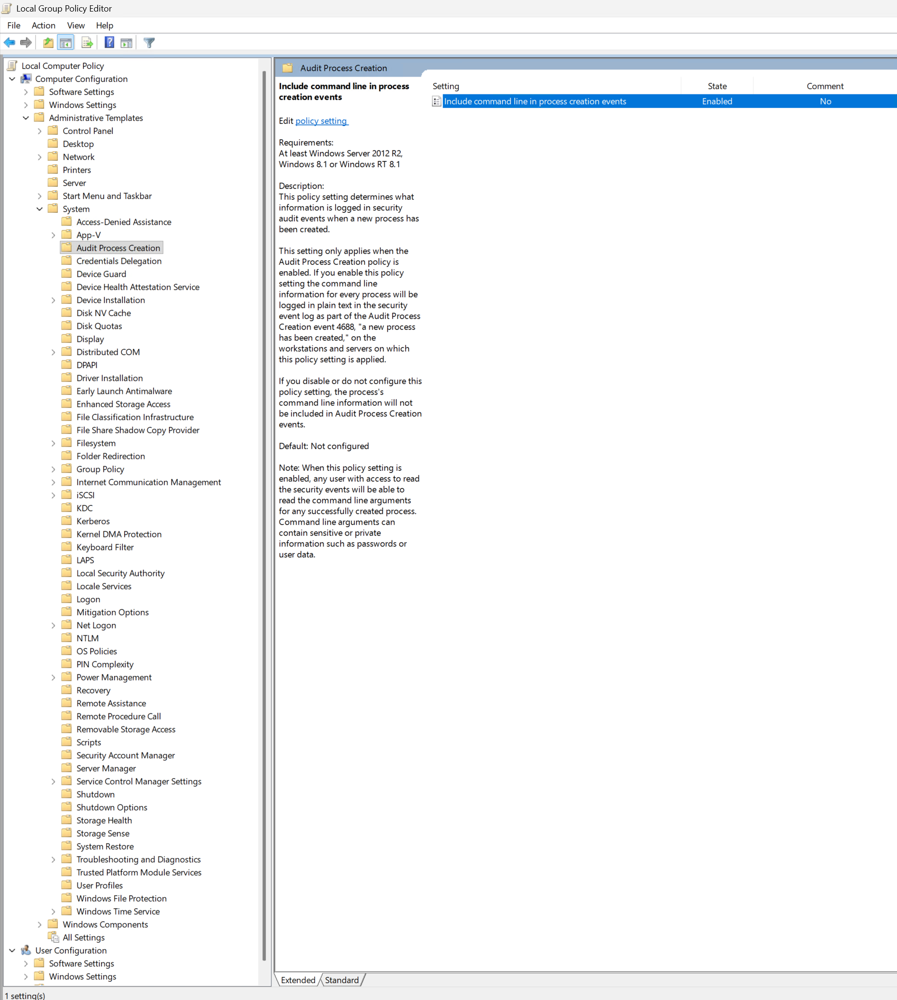
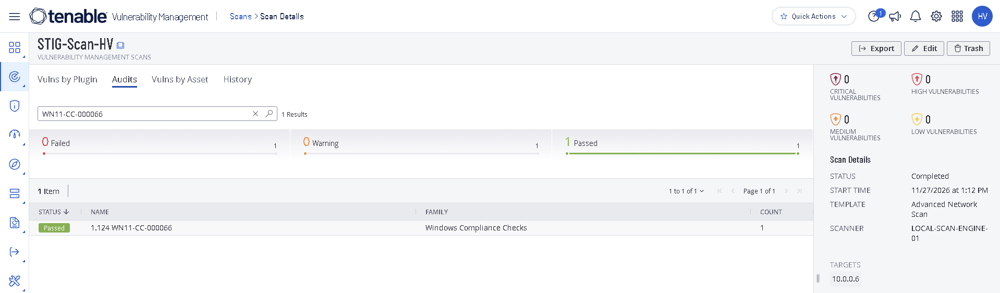
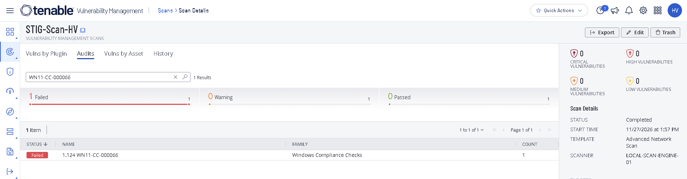
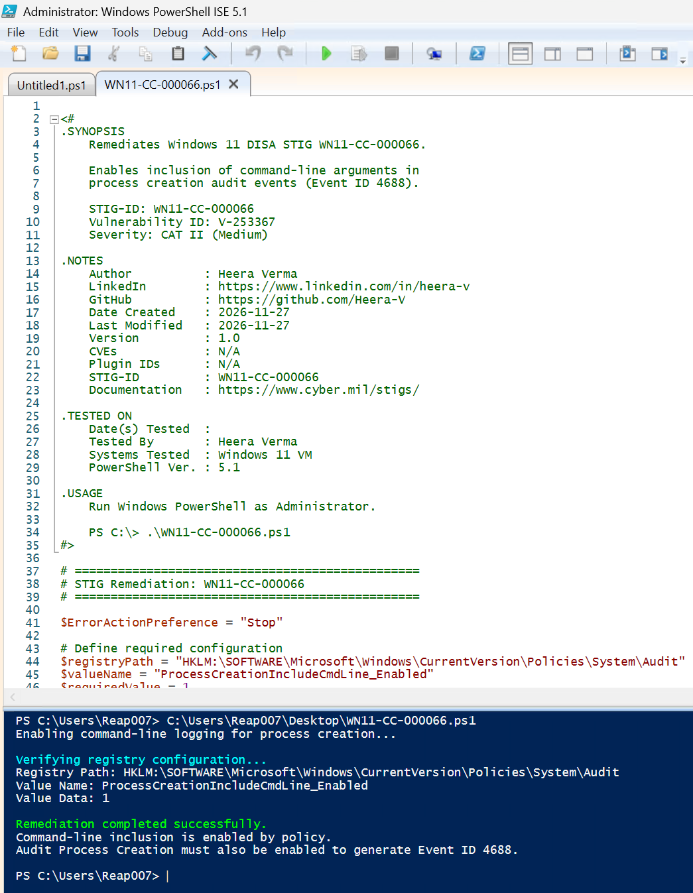
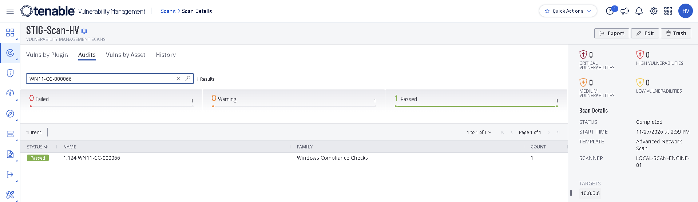

# WN11-CC-000066 — Include Command Line in Process Creation Events

## Overview

This project demonstrates the identification, manual remediation, rollback, and automated remediation of Windows 11 DISA STIG control **WN11-CC-000066** using Local Group Policy, PowerShell, and Tenable Vulnerability Management.

The security control requires Windows to enable **Include command line in process creation events**.

When Process Creation auditing is enabled, this setting adds command-line information to Windows Security Event ID 4688, improving visibility into process execution.

## Security Risk

Without command-line information in process creation audit events, security analysts may have limited visibility into how programs were executed.

This can make it more difficult to investigate:

- Suspicious PowerShell execution.
- Potentially malicious command-line arguments.
- Unauthorized software execution.
- Suspicious process activity.
- Indicators of compromise during incident investigations.

Command-line logging provides additional context for threat hunting and forensic analysis.

**Security Consideration:** Command-line arguments may contain sensitive information. Access to Windows Security event logs should be appropriately restricted.

## Lab Environment

| Component | Technology |
|---|---|
| Operating System | Windows 11 VM |
| Compliance Scanner | Tenable Vulnerability Management |
| Automation | Windows PowerShell 5.1 |
| Manual Configuration | Local Group Policy Editor |
| Security Framework | DISA Windows 11 STIG |
| STIG ID | WN11-CC-000066 |
| Vulnerability ID | V-253367 |
| Tenable Audit ID | 1.124 |
| Severity | CAT II (Medium) |
| Verification Date | November 27, 2026 |

## Initial Finding

The original Tenable compliance scan identified **WN11-CC-000066 as FAILED**.

The Windows policy **Include command line in process creation events** was set to **Not Configured**, which did not satisfy the required security configuration.

### Initial Tenable Scan — FAILED



### Original Group Policy Configuration

The setting was inspected at:

Computer Configuration → Administrative Templates → System → Audit Process Creation → Include command line in process creation events

**Original State:** Not Configured



## Manual Remediation

The security setting was first configured manually using Local Group Policy Editor (`gpedit.msc`).

### Manual Configuration Steps

1. Open Local Group Policy Editor.
2. Navigate to Computer Configuration → Administrative Templates → System → Audit Process Creation.
3. Open "Include command line in process creation events".
4. Select **Enabled**.
5. Click Apply and OK.

### Manual Remediation Evidence



### Manual Remediation Verification — PASSED

After enabling the policy, a Tenable compliance scan was performed.

Tenable confirmed that **WN11-CC-000066 changed from FAILED to PASSED**.



## Remediation Rollback Testing

Following the internship remediation methodology, the manual configuration was reversed before implementing automation.

The Group Policy setting was restored to its original state:

**Not Configured**

### Rollback Verification — FAILED

A subsequent Tenable compliance scan confirmed that **WN11-CC-000066 returned to FAILED**.

This demonstrated that the manual configuration change directly affected the compliance result.



## PowerShell Automated Remediation

After confirming the rollback, a reusable PowerShell script was created to automate the security configuration.

### Registry Configuration

| Setting | Required Value |
|---|---|
| Registry Path | `HKLM\SOFTWARE\Microsoft\Windows\CurrentVersion\Policies\System\Audit` |
| Value Name | `ProcessCreationIncludeCmdLine_Enabled` |
| Registry Type | REG_DWORD |
| Required Value | 1 |
| Policy State | Enabled |

### Core Remediation Command

```powershell
New-ItemProperty `
    -Path "HKLM:\SOFTWARE\Microsoft\Windows\CurrentVersion\Policies\System\Audit" `
    -Name "ProcessCreationIncludeCmdLine_Enabled" `
    -PropertyType DWord `
    -Value 1 `
    -Force
```

The complete script performs the following operations:

1. Verifies administrator privileges.
2. Defines the required registry path and value.
3. Creates the registry key if missing.
4. Sets `ProcessCreationIncludeCmdLine_Enabled` to `1`.
5. Retrieves the configured registry value.
6. Verifies that the value matches the required configuration.
7. Reports remediation success or an error.

### Full PowerShell Script

**[View WN11-CC-000066.ps1 — PowerShell Remediation Script](WN11-CC-000066.ps1)**

### PowerShell Script Execution

The remediation script was executed using Windows PowerShell ISE 5.1 with administrator privileges.

The script confirmed:

```text
Value Name: ProcessCreationIncludeCmdLine_Enabled
Value Data: 1

Remediation completed successfully.
Command-line inclusion is enabled by policy.
```



## Final Verification and Results

Following the PowerShell remediation, another Tenable compliance scan was performed.

Tenable confirmed that **WN11-CC-000066 changed from FAILED to PASSED**.

### Final Tenable Scan — PASSED



### Before and After Comparison

| Stage | Configuration | Tenable Result |
|---|---|---|
| Initial Assessment | Not Configured | FAILED |
| Manual Remediation | Enabled | PASSED |
| Group Policy Rollback | Not Configured | FAILED |
| PowerShell Remediation | Registry DWORD = 1 | PASSED |

**Final Result:** The Windows 11 VM successfully met the DISA STIG requirement for including command-line information in process creation audit events.

The required setting was validated through manual configuration, rollback testing, PowerShell automation, and Tenable compliance scanning.

Note: The separate Audit Process Creation setting must also be enabled for Windows to generate Event ID 4688. This remediation specifically addresses the command-line inclusion requirement.

## Skills Demonstrated

- DISA STIG compliance remediation
- Windows 11 security hardening
- Windows Local Group Policy configuration
- Windows Registry configuration
- PowerShell scripting and automation
- Windows Security Event ID 4688 concepts
- Process execution monitoring
- Tenable compliance scanning
- Remediation rollback and validation
- Technical documentation and evidence collection

## Security Concepts Learned

### Process Creation Auditing

Windows Event ID 4688 records information about newly created processes when Process Creation auditing is enabled.

### Command-Line Logging

Command-line inclusion provides additional context about how a process was launched, helping analysts investigate suspicious commands.

### Manual vs. Automated Remediation

Manual configuration allows administrators to understand and test a setting. PowerShell automation provides a repeatable method for implementing it.

### Rollback Testing

Rollback testing verifies that configuration changes can be reversed and confirms their relationship to compliance findings.

### Compliance Validation

Successful PowerShell execution alone does not guarantee STIG compliance. A subsequent Tenable scan provides independent verification of the required configuration.

## Author

**Heera Verma**

[GitHub](https://github.com/Heera-V) | [LinkedIn](https://www.linkedin.com/in/heera-v)
