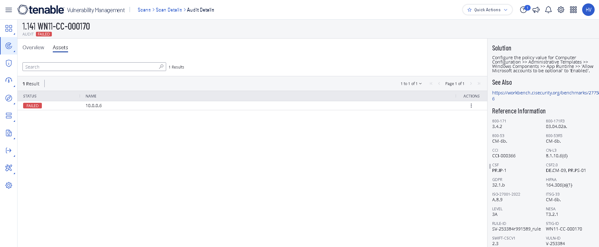
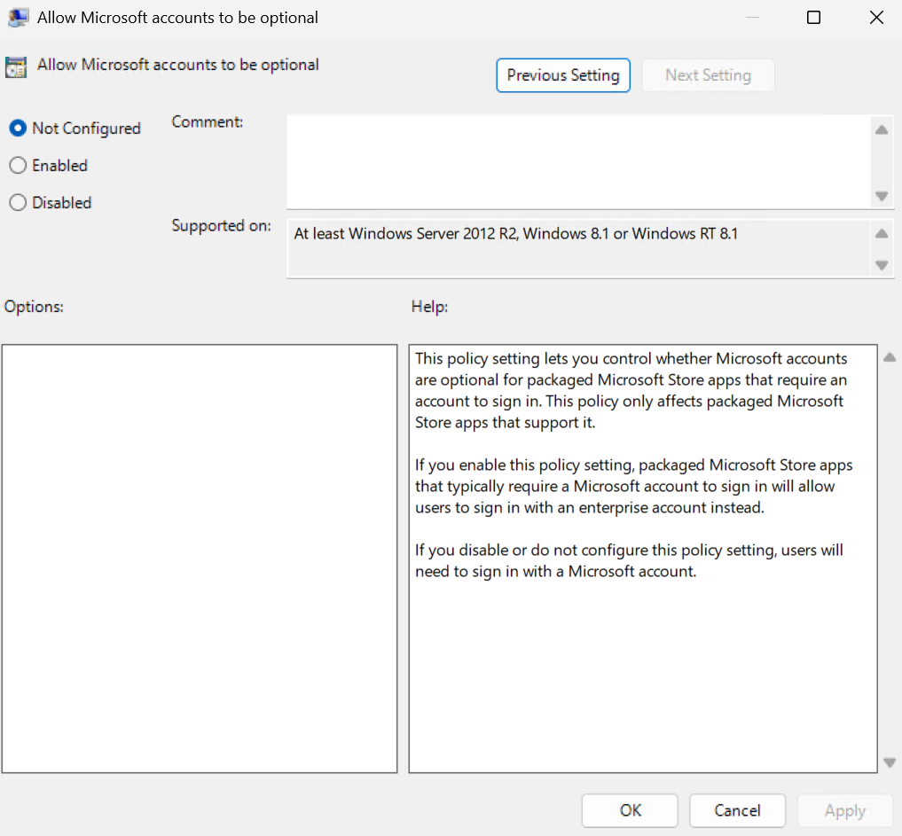
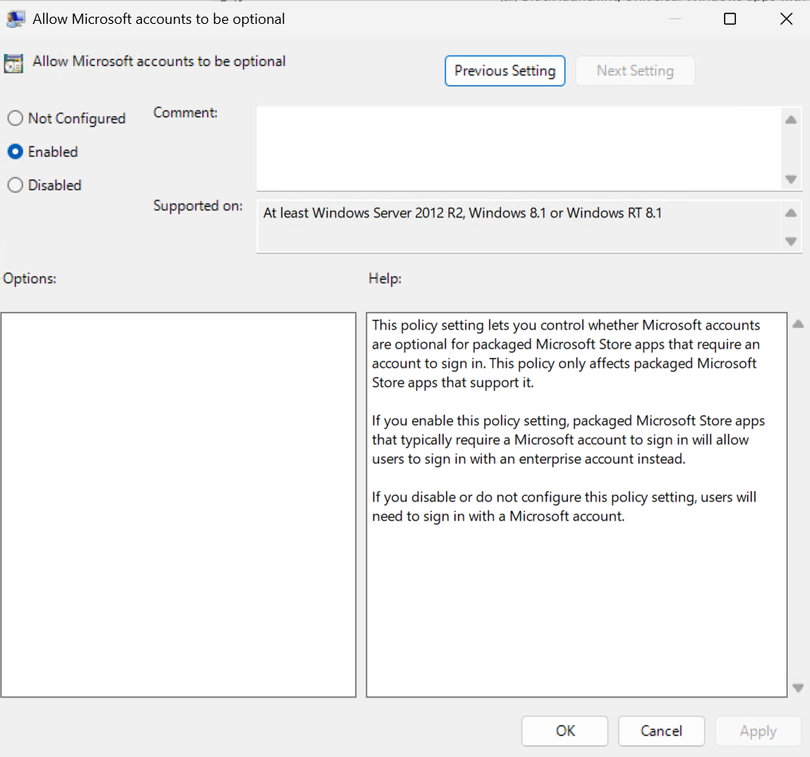
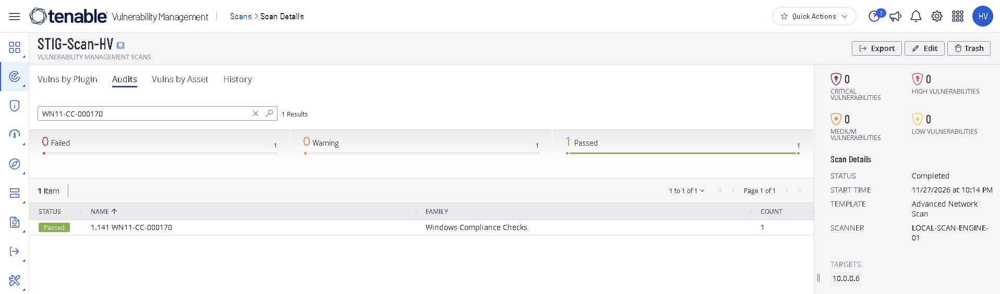
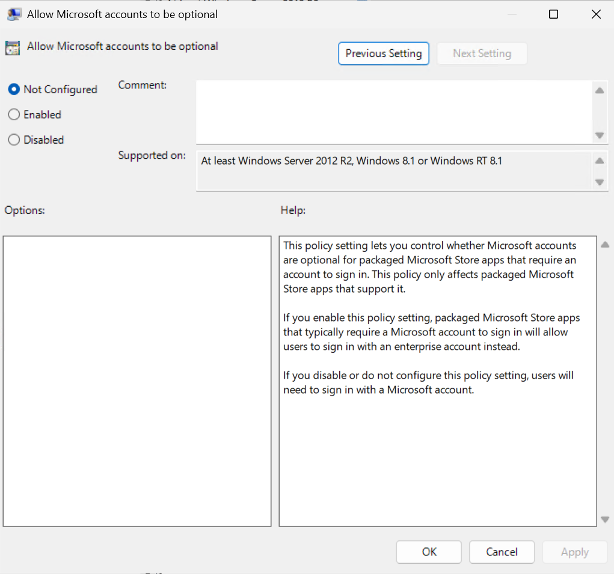
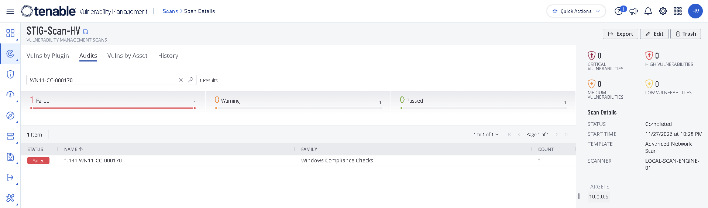
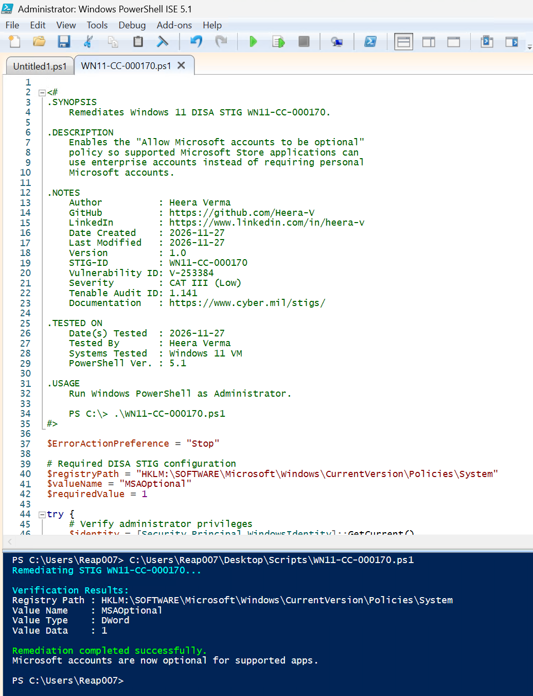
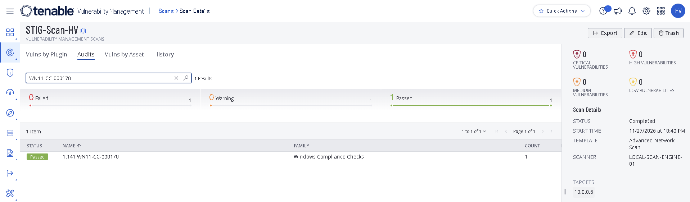

# WN11-CC-000170 — Allow Microsoft Accounts to Be Optional

## Overview

This Windows 11 DISA STIG remediation project demonstrates assessment, manual Group Policy hardening, rollback validation, PowerShell automation, and independent Tenable compliance verification for **WN11-CC-000170**.

| Detail | Value |
|---|---|
| STIG ID | **WN11-CC-000170** |
| Vulnerability ID | V-253384 |
| Tenable Audit ID | **1.141** |
| Severity | CAT III (Low) |
| Policy | Allow Microsoft accounts to be optional |
| Required state | **Enabled** |
| Target | Windows 11 virtual machine — `10.0.0.6` |
| Automation | Windows PowerShell ISE 5.1 |
| Verification date | November 27, 2026 |
| Final Tenable result | **PASSED — 10:40 PM** |
| Evidence publication | **All 8 screenshots uploaded and linked** |

## Security Context

The **Allow Microsoft accounts to be optional** setting enables supported packaged Microsoft Store applications to use an enterprise account rather than requiring a personal Microsoft account. This supports account-management requirements in enterprise environments. The setting applies to packaged Store applications that support the policy; it does not replace enterprise identity controls for all Windows applications.

## Initial Finding — FAILED

The baseline Tenable compliance audit identified **1.141 WN11-CC-000170** as **FAILED**. The original local policy was **Not Configured**.

### Initial Tenable Scan — FAILED



### Group Policy — Before Remediation

Using Local Group Policy Editor (`gpedit.msc`), the setting was inspected at:

**Computer Configuration → Administrative Templates → Windows Components → App Runtime → Allow Microsoft accounts to be optional**

The policy was **Not Configured**, whereas the STIG requires it to be **Enabled**.



## Manual Remediation — PASSED

1. Open `gpedit.msc`.
2. Navigate to **Computer Configuration → Administrative Templates → Windows Components → App Runtime**.
3. Open **Allow Microsoft accounts to be optional**.
4. Select **Enabled** and choose **Apply → OK**.
5. Reopen the policy to verify it remains **Enabled**.

### Group Policy — Manual Remediation



### Tenable Verification After Manual Remediation — PASSED

The subsequent `STIG-Scan-HV` scan reported **PASSED** on **November 27, 2026 at 10:14 PM**.



## Rollback Validation — FAILED

Before testing the PowerShell automation, the policy was restored from **Enabled** to its original **Not Configured** state.

### Group Policy — Rollback



### Tenable Verification After Rollback — FAILED

Tenable returned **FAILED** for the audit on **November 27, 2026 at 10:28 PM**, validating the change in compliance status.



## Automated PowerShell Remediation

A PowerShell 5.1 script was executed as Administrator to configure the corresponding Windows policy registry value.

**[View the complete WN11-CC-000170.ps1 script](WN11-CC-000170.ps1)**

### Required Registry Configuration

| Registry setting | Required value |
|---|---|
| Path | `HKLM\SOFTWARE\Microsoft\Windows\CurrentVersion\Policies\System` |
| Value name | `MSAOptional` |
| Type | `REG_DWORD` |
| Data | `1` (Enabled) |

### Core PowerShell Remediation

```powershell
New-ItemProperty `
    -Path "HKLM:\SOFTWARE\Microsoft\Windows\CurrentVersion\Policies\System" `
    -Name "MSAOptional" `
    -PropertyType DWord `
    -Value 1 `
    -Force | Out-Null
```

The full script checks administrator privileges, creates the registry path if required, sets the DWORD, and verifies both the value and its data type.

### PowerShell Execution — Successful

PowerShell ISE 5.1 reported:

```text
Value Name    : MSAOptional
Value Type    : DWord
Value Data    : 1

Remediation completed successfully.
Microsoft accounts are now optional for supported apps.
```



## Final Tenable Verification — PASSED

Following script execution, a final `STIG-Scan-HV` compliance scan of Windows 11 VM `10.0.0.6` returned **PASSED** for **1.141 WN11-CC-000170** on **November 27, 2026 at 10:40 PM**.



### Validation Summary

| Stage | Configuration | Result |
|---|---|---|
| Initial scan | Not Configured | **Tenable FAILED** |
| Manual Group Policy remediation | Enabled | **Tenable PASSED** |
| Rollback | Not Configured | **Tenable FAILED** |
| PowerShell remediation | `MSAOptional = 1` (`REG_DWORD`) | **Successful** |
| Final compliance rescan | Enabled | **Tenable PASSED** |

## Evidence Verification

All **8 evidence screenshots** have been uploaded to the `Screenshots/` folder and their filenames have been checked against the inline README image references. No evidence images are missing.

## Skills Demonstrated

- Windows 11 DISA STIG compliance remediation
- Group Policy assessment and hardening
- Windows application and enterprise account policy
- Registry-based automation with PowerShell 5.1
- Administrative privilege checks and post-change verification
- Controlled rollback testing
- Tenable Vulnerability Management rescanning
- Security evidence capture and technical documentation

## Author

**Heera Verma** — [GitHub](https://github.com/Heera-V) · [LinkedIn](https://www.linkedin.com/in/heera-v)
