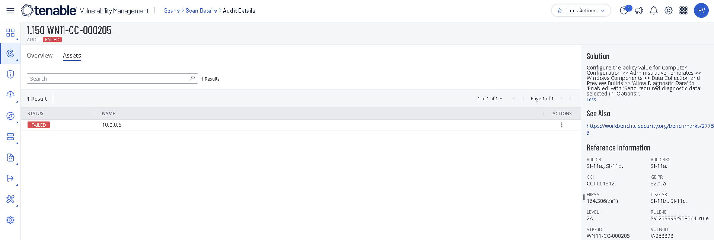
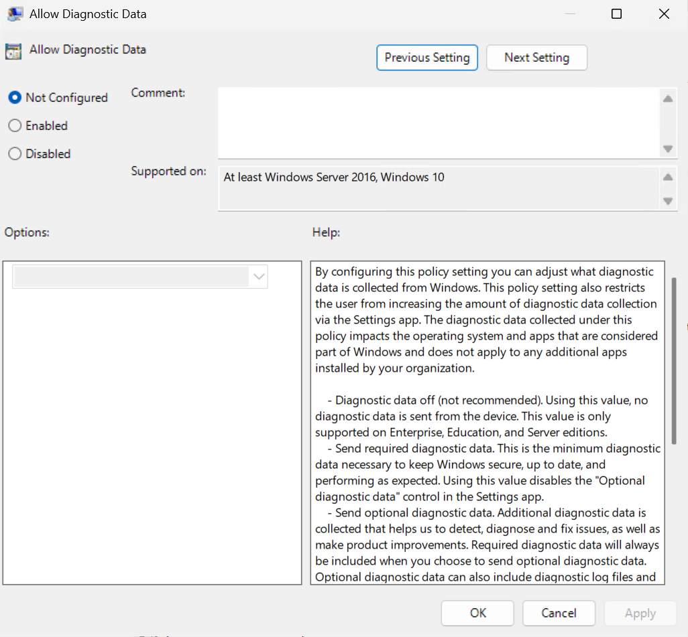
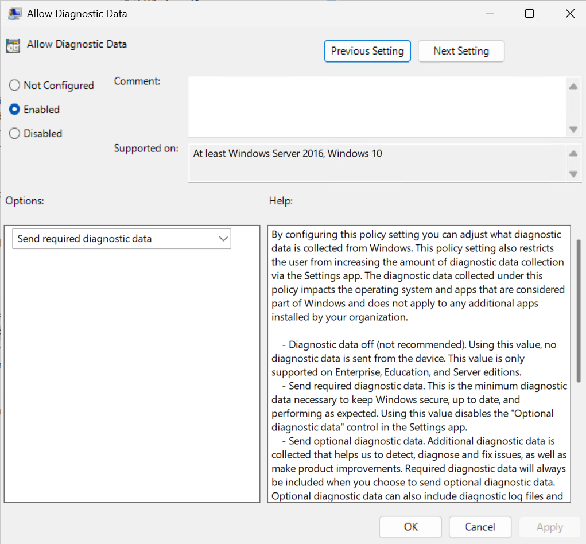
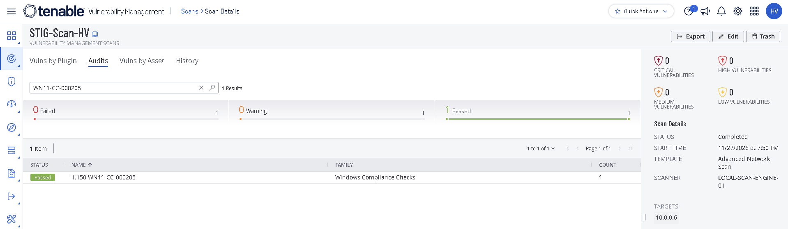
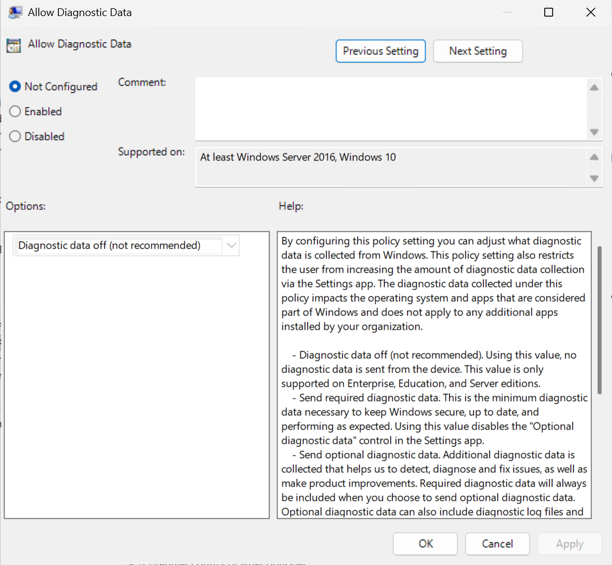
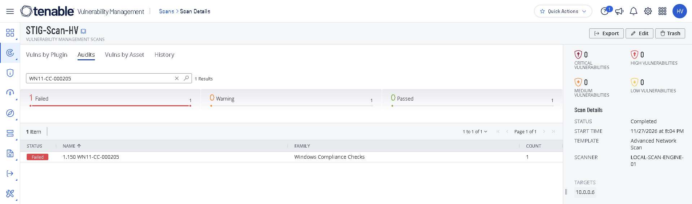
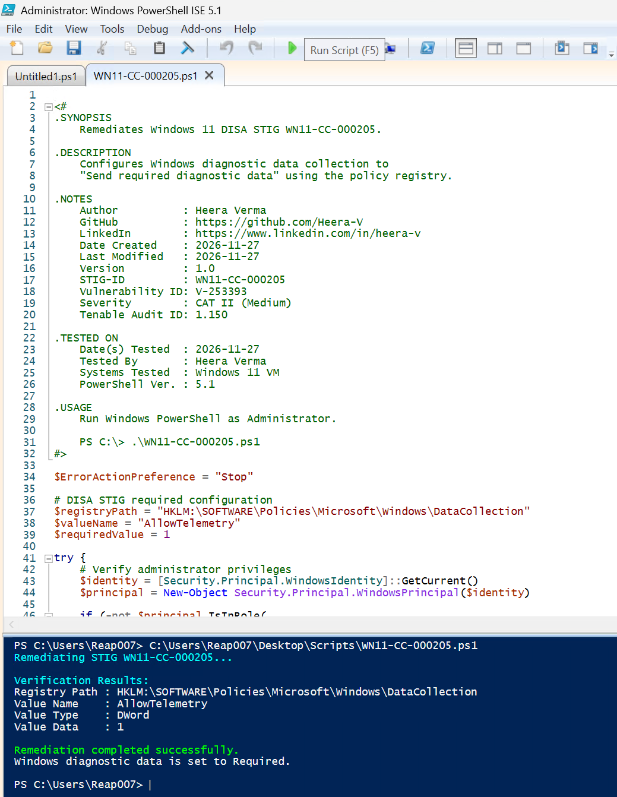
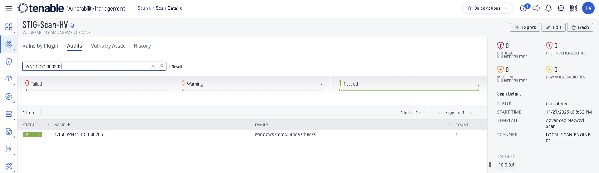

# WN11-CC-000205 — Configure Windows Diagnostic Data

## Overview

This Windows 11 DISA STIG lab documents a failed diagnostic data policy, manual Group Policy remediation, Tenable verification, rollback, and automated PowerShell remediation.

| Detail | Value |
|---|---|
| STIG ID | **WN11-CC-000205** |
| Vulnerability ID | V-253393 |
| Tenable Audit ID | **1.150** |
| Severity | CAT II (Medium) |
| Control | Allow Diagnostic Data |
| Required configuration | **Enabled — Send required diagnostic data** |
| Target | Windows 11 VM — 10.0.0.6 |
| Automation | PowerShell ISE 5.1 |
| Test date | November 27, 2026 |
| Status | **PASSED — final Tenable evidence uploaded** |

## Security Risk

Windows collects diagnostic data for troubleshooting, reliability, and system improvements. Configuring the policy to send only required diagnostic data limits optional collection and provides administrators with a consistent, auditable configuration.

This control concerns diagnostic-data collection, not the complete elimination of telemetry or a guarantee that no sensitive information can ever be collected.

## Initial Finding — FAILED

The initial Tenable compliance audit **1.150 WN11-CC-000205** reported **FAILED** for VM **10.0.0.6**.

### Initial Tenable Scan — FAILED

### Original Group Policy Configuration — Not Configured

The original setting was inspected in Local Group Policy Editor:

**Computer Configuration → Administrative Templates → Windows Components → Data Collection and Preview Builds → Allow Diagnostic Data**

The policy was **Not Configured**, which did not satisfy the required explicit configuration.

## Manual Remediation — PASSED

1. Open `gpedit.msc`.
2. Navigate to **Computer Configuration → Administrative Templates → Windows Components → Data Collection and Preview Builds**.
3. Open **Allow Diagnostic Data**.
4. Select **Enabled**.
5. Under **Options**, select **Send required diagnostic data**.
6. Click **Apply → OK**, then reopen the policy to verify the selection.

### Manual Group Policy Configuration

### Tenable Verification After Manual Remediation — PASSED

A rescan of `STIG-Scan-HV` returned **PASSED** for **WN11-CC-000205** on **November 27, 2026 at 7:50 PM**.

## Rollback Testing — FAILED

The policy was restored to its original **Not Configured** state before automation was tested.

### Group Policy Rollback — Not Configured

### Tenable Verification After Rollback — FAILED

A Tenable rescan confirmed the finding returned to **FAILED** on **November 27, 2026 at 8:04 PM**, demonstrating that the manual setting affected the compliance result.

## PowerShell Automated Remediation

The remediation was automated using a PowerShell 5.1 script executed with administrator privileges.

**[View the complete PowerShell remediation script](WN11-CC-000205.ps1)**

### Required Registry Configuration

| Configuration | Value |
|---|---|
| Registry path | `HKLM\SOFTWARE\Policies\Microsoft\Windows\DataCollection` |
| Value name | `AllowTelemetry` |
| Registry type | `REG_DWORD` |
| Value data | `1` |
| Meaning | Send required diagnostic data |

### Core Remediation

~~~powershell
New-ItemProperty `
    -Path "HKLM:\SOFTWARE\Policies\Microsoft\Windows\DataCollection" `
    -Name "AllowTelemetry" `
    -PropertyType DWord `
    -Value 1 `
    -Force | Out-Null
~~~

The full script verifies administrator rights, creates the registry key if necessary, writes the required DWORD, verifies its type and value, and reports an error if verification fails.

### PowerShell Execution — Successful

Windows PowerShell ISE 5.1 reported:

~~~text
Value Name    : AllowTelemetry
Value Type    : DWord
Value Data    : 1

Remediation completed successfully.
Windows diagnostic data is set to Required.
~~~

## Final Tenable Verification — PASSED

The script successfully configured the required registry value. The final Tenable result has been uploaded as **Tenable-Passed-Powershell.png** for audit **1.150 WN11-CC-000205**, documenting the post-automation **PASSED** compliance result.

### Remediation Summary

| Stage | Configuration | Result |
|---|---|---|
| Initial scan | Not Configured | **FAILED** |
| Manual remediation | Enabled — Send required diagnostic data | **PASSED** |
| Rollback | Not Configured | **FAILED** |
| PowerShell remediation | `AllowTelemetry = 1` (`REG_DWORD`) | **Script successful** |
| Final Tenable verification | `AllowTelemetry = 1` | **PASSED (uploaded evidence)** |

## Skills Demonstrated

- Windows 11 DISA STIG compliance remediation
- Group Policy administration
- Windows diagnostic-data privacy configuration
- Registry-based security configuration
- PowerShell 5.1 scripting and verification
- Rollback and repeatability testing
- Tenable Vulnerability Management audit validation
- Technical evidence collection and documentation

## Author

**Heera Verma** — [GitHub](https://github.com/Heera-V) · [LinkedIn](https://www.linkedin.com/in/heera-v)
