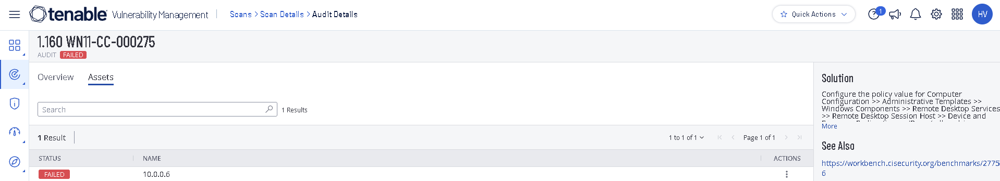
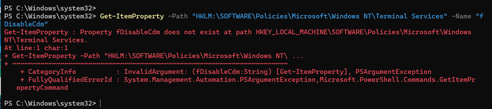
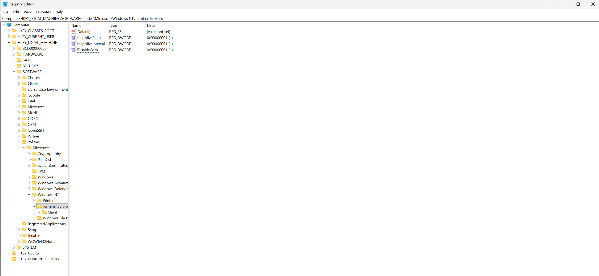
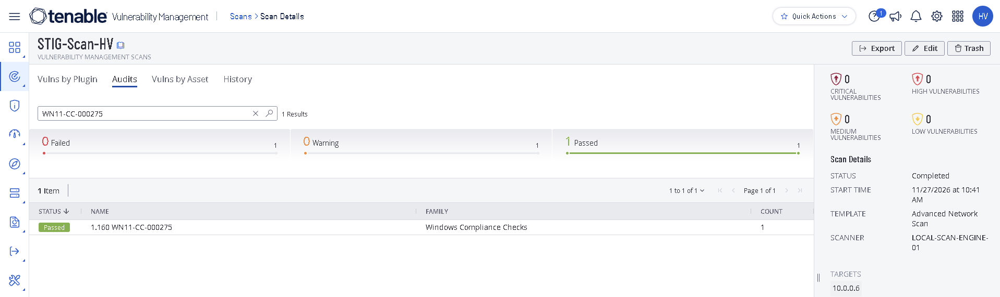
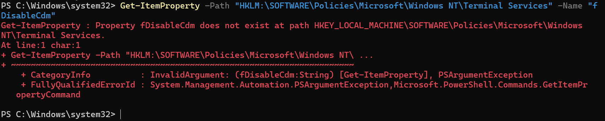
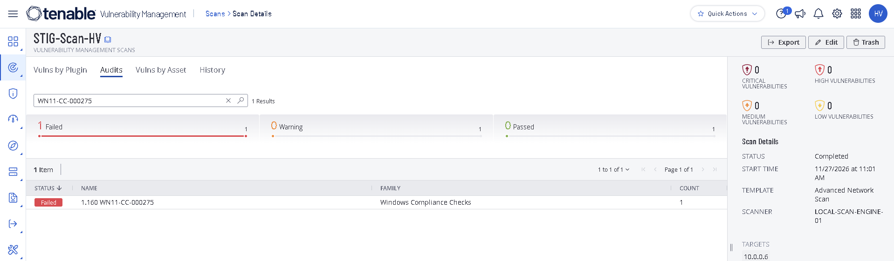
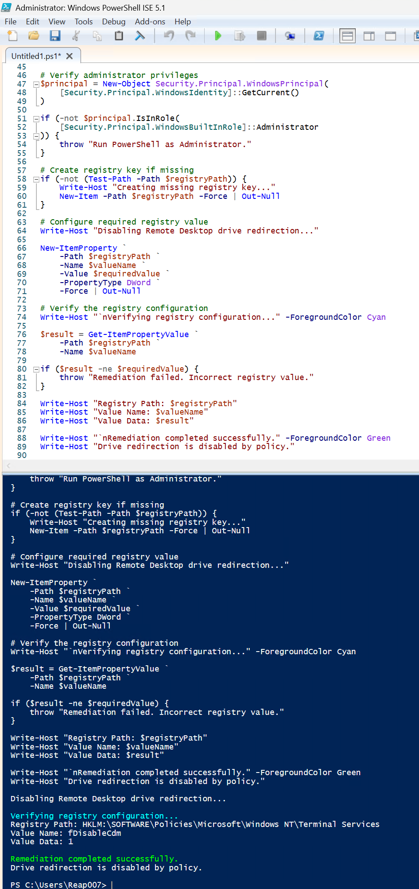

# WN11-CC-000275 — Do Not Allow Drive Redirection

## Overview

This project demonstrates the identification, remediation, rollback, and validation of Windows 11 DISA STIG control **WN11-CC-000275** using Windows Registry Editor, PowerShell automation, and Tenable Vulnerability Management.

This security control requires Windows to prevent local drive redirection during Remote Desktop sessions.

The objective is to reduce the risk of unauthorized access to files and data transferred between local and remote systems.

## Security Risk

Remote Desktop Protocol (RDP) allows users to connect to remote Windows systems.

When drive redirection is permitted, drives belonging to the connecting computer can become accessible inside the remote session.

This introduces potential security risks, including:

- Unauthorized access to redirected local drives.
- Exposure of sensitive information through remote sessions.
- Unintentional copying of files between systems.
- Increased opportunities for data exfiltration if a remote session is compromised.

Disabling drive redirection helps restrict access to local storage resources during Remote Desktop sessions.

## Lab Environment

| Component | Technology |
|---|---|
| Operating System | Windows 11 VM |
| Compliance Scanner | Tenable Vulnerability Management |
| Automation | Windows PowerShell 5.1 |
| Manual Configuration | Windows Registry Editor |
| Security Framework | DISA Windows 11 STIG |
| STIG ID | WN11-CC-000275 |
| Tenable Audit ID | 1.160 |
| Severity | CAT II (Medium) |
| Verification Date | November 27, 2026 |

## Initial Finding

The initial Tenable compliance scan identified **WN11-CC-000275 as FAILED**.

The required registry configuration for preventing Remote Desktop drive redirection was not present.

### Initial Tenable Scan — FAILED

### Initial Registry Verification

The registry configuration was inspected using PowerShell:

    Get-ItemProperty -Path "HKLM:\SOFTWARE\Policies\Microsoft\Windows NT\Terminal Services" -Name "fDisableCdm"

The command returned an error indicating that the `fDisableCdm` value did not exist.

This confirmed that the required registry policy value was missing.

## Manual Remediation

The registry configuration was first implemented manually using Windows Registry Editor (`regedit`).

### Registry Configuration

**Registry Path:**

`HKEY_LOCAL_MACHINE\SOFTWARE\Policies\Microsoft\Windows NT\Terminal Services`

**Required Configuration:**

| Setting | Required Value |
|---|---|
| Registry Value | fDisableCdm |
| Registry Type | REG_DWORD |
| Value Data | 1 |
| Policy | Do not allow drive redirection |
| Required Policy State | Enabled |

### Manual Remediation Steps

1. Open Windows Registry Editor as Administrator.
2. Navigate to the Terminal Services registry key.
3. Create a new DWORD (32-bit) value.
4. Name the value `fDisableCdm`.
5. Configure the value data to `1`.
6. Verify that the registry value displays `0x00000001 (1)`.

The value `1` enables the Windows policy that prevents local drive redirection during Remote Desktop sessions.

### Manual Registry Configuration Evidence

### Manual Remediation Verification — PASSED

After implementing the registry configuration, a Tenable compliance scan was performed.

Tenable confirmed that **WN11-CC-000275 changed from FAILED to PASSED**.

## Remediation Rollback Testing

To validate the remediation process and prepare for PowerShell automation, the manual registry change was reversed.

Because the `fDisableCdm` value was originally missing, rollback involved deleting only the newly created registry value.

The remaining Terminal Services registry settings were preserved.

### Rollback Verification

After deleting the value, PowerShell was used to verify that `fDisableCdm` no longer existed.

### Tenable Rollback Verification — FAILED

A subsequent Tenable compliance scan confirmed that **WN11-CC-000275 returned to FAILED** after the manual remediation was reversed.

This demonstrated that the registry change directly affected the compliance result.

## PowerShell Automated Remediation

After confirming the rollback, a reusable PowerShell script was developed to implement the required registry configuration automatically.

The script performs the following operations:

1. Verifies that PowerShell is running with administrator privileges.
2. Defines the required registry path, value name, and value data.
3. Checks whether the registry key exists.
4. Creates the registry key if necessary.
5. Creates or updates `fDisableCdm` as a DWORD with value `1`.
6. Reads the registry value to verify the configuration.
7. Reports successful remediation or raises an error if verification fails.

### Core Remediation Command

The following PowerShell command configures the required registry policy:

    New-ItemProperty `
        -Path "HKLM:\SOFTWARE\Policies\Microsoft\Windows NT\Terminal Services" `
        -Name "fDisableCdm" `
        -Value 1 `
        -PropertyType DWord `
        -Force

This command creates or updates the required registry value.

### Full PowerShell Script

**[View WN11-CC-000275.ps1 — PowerShell Remediation Script](WN11-CC-000275.ps1)**

### PowerShell Script Execution

The automated remediation script was executed using Windows PowerShell ISE 5.1 with administrator privileges.

The output confirmed that the registry policy was successfully configured.

**Verified Configuration:**

    Registry Path: HKLM:\SOFTWARE\Policies\Microsoft\Windows NT\Terminal Services
    Value Name: fDisableCdm
    Value Data: 1

    Remediation completed successfully.
    Drive redirection is disabled by policy.

## Final Verification and Results

Following execution of the PowerShell remediation script, another Tenable compliance scan was performed.

Tenable confirmed that **WN11-CC-000275 changed from FAILED to PASSED**.

### Final Tenable Scan — PASSED

### Remediation Results

| Stage | Configuration | Tenable Result |
|---|---|---|
| Initial Assessment | fDisableCdm missing | FAILED |
| Manual Remediation | fDisableCdm = 1 | PASSED |
| Registry Rollback | fDisableCdm removed | FAILED |
| PowerShell Remediation | fDisableCdm = 1 | PASSED |

**Final Result:** The Windows 11 VM successfully met the DISA STIG requirement to prevent Remote Desktop drive redirection.

The remediation was validated through both manual registry configuration and an automated PowerShell script, with Tenable confirming the expected compliance changes.

## Skills Demonstrated

- DISA STIG compliance remediation
- Windows 11 security hardening
- Windows Registry configuration
- PowerShell scripting and automation
- Remote Desktop security configuration
- Registry backup and rollback concepts
- Tenable vulnerability and compliance scanning
- Remediation testing and validation
- Troubleshooting Windows security policies
- Technical documentation and evidence collection

## Security Concepts Learned

### Remote Desktop Drive Redirection

RDP drive redirection allows drives from a connecting computer to become available within a remote Windows session.

Restricting this functionality reduces unnecessary access to local storage resources.

### Windows Registry Security Policies

Windows stores many administrative policy settings in the registry.

Configuring the appropriate policy keys and values allows administrators to enforce specific security requirements.

### Manual vs. Automated Remediation

Manual remediation involves configuring Windows settings directly through tools such as Registry Editor.

Automated remediation uses PowerShell to apply the same settings consistently and repeatably.

### Rollback Testing

Rollback testing verifies that a configuration change can be reversed and helps demonstrate the relationship between a security setting and its compliance result.

### Compliance Validation

A successful registry modification or PowerShell execution does not independently guarantee compliance.

Tenable provides separate verification that the system configuration satisfies the selected DISA STIG benchmark.

## Author

**Heera Verma**

[GitHub](https://github.com/Heera-V) | [LinkedIn](https://www.linkedin.com/in/heera-v)
