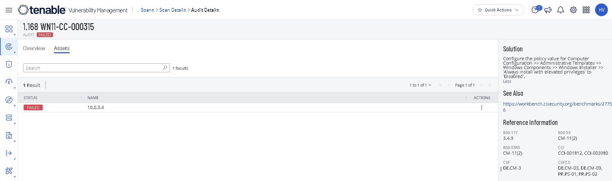
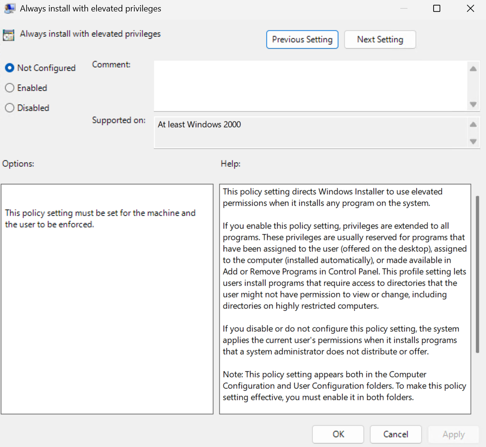
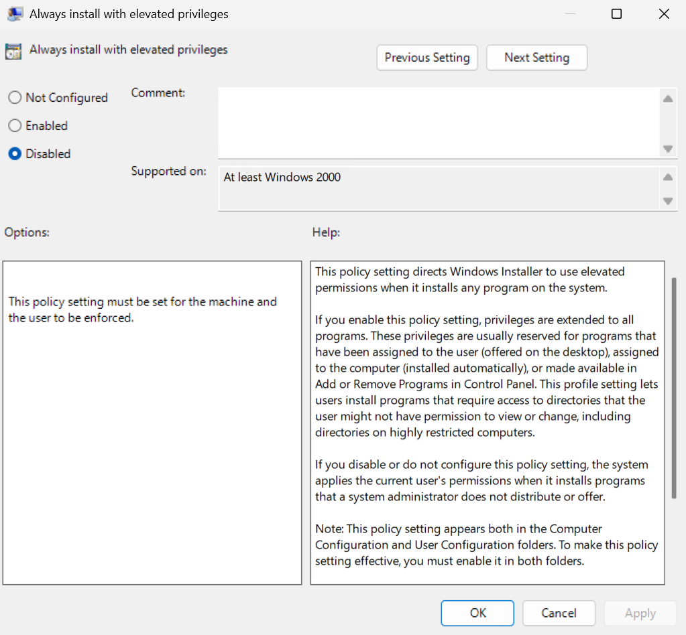
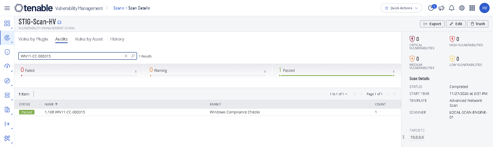
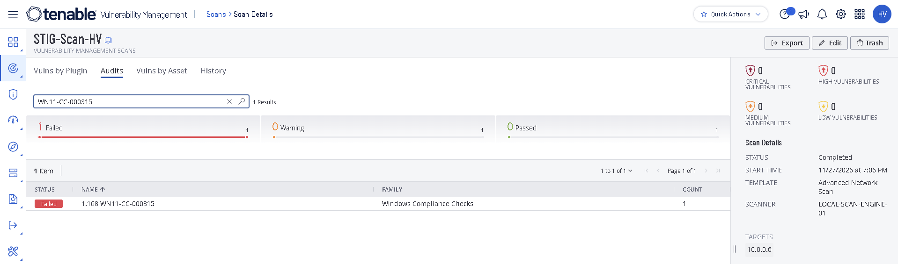
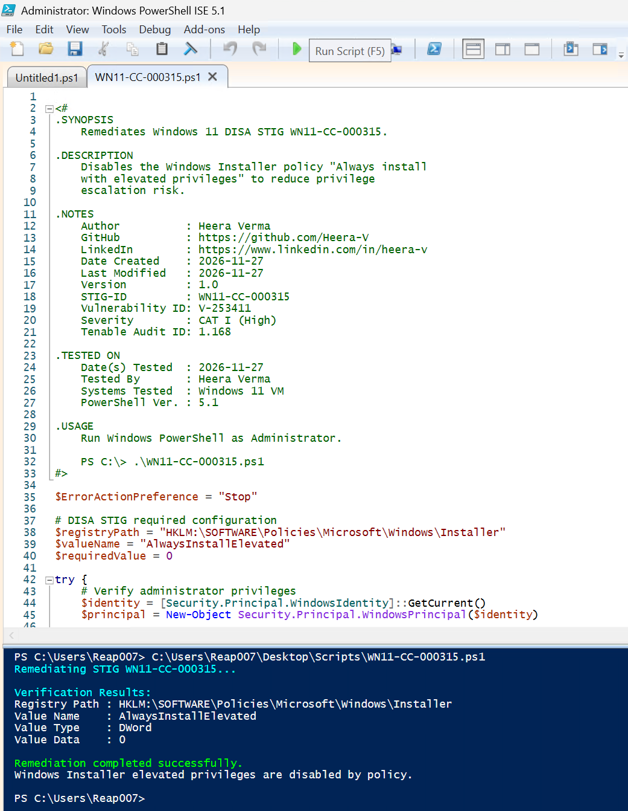
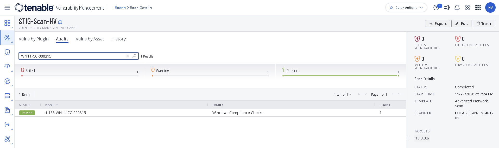

# WN11-CC-000315 — Disable Windows Installer Elevated Privileges

## Overview

This project demonstrates the identification, manual remediation, rollback testing, and PowerShell automation of Windows 11 DISA STIG **WN11-CC-000315**, which requires the computer-level **Always install with elevated privileges** policy to be **Disabled**.

| Detail | Value |
|---|---|
| STIG | WN11-CC-000315 |
| Tenable Audit ID | 1.168 |
| Vulnerability ID | V-253411 |
| Severity | CAT I (High) |
| Target | Windows 11 VM — 10.0.0.6 |
| PowerShell | Windows PowerShell ISE 5.1 |
| Date | November 27, 2026 |
| Status | **PowerShell remediation successful; final Tenable scan pending** |

## Security Risk

The **Always install with elevated privileges** policy can allow Windows Installer packages to install with elevated permissions when enabled in both Computer Configuration and User Configuration. Attackers could misuse this behavior to gain elevated execution privileges through an installer package.

Explicitly disabling the **Computer Configuration** policy meets the requirements for this particular STIG. The corresponding User Configuration setting should also be assessed separately.

## Initial Finding — FAILED

The initial Tenable assessment reported **FAILED** for **1.168 WN11-CC-000315**.

### Initial Tenable Scan — FAILED



### Original Group Policy Configuration — Not Configured

Using **Local Group Policy Editor** (`gpedit.msc`), the following setting was inspected:

`Computer Configuration > Administrative Templates > Windows Components > Windows Installer > Always install with elevated privileges`

The original state was **Not Configured**, while the compliance requirement specifies **Disabled**.



## Manual Remediation

1. Open Local Group Policy Editor with `gpedit.msc`.
2. Navigate to **Computer Configuration → Administrative Templates → Windows Components → Windows Installer**.
3. Double-click **Always install with elevated privileges**.
4. Select **Disabled**, then **Apply → OK**.
5. Reopen the policy to confirm the state.

### Group Policy — Disabled



### Tenable Verification After Manual Remediation — PASSED

The subsequent `STIG-Scan-HV` audit reported **PASSED** at **6:51 PM on November 27, 2026**.



## Rollback Verification — FAILED

For testing, the policy was restored from **Disabled** to its original **Not Configured** state. Another Tenable scan returned **FAILED** at **7:06 PM on November 27, 2026**, confirming the control's behavior.



## PowerShell Automated Remediation

A repeatable Windows PowerShell 5.1 script was used to explicitly disable this policy through the registry.

**[View the complete WN11-CC-000315.ps1 remediation script](WN11-CC-000315.ps1)**

### Required Registry Configuration

| Setting | Required value |
|---|---|
| Path | `HKLM\SOFTWARE\Policies\Microsoft\Windows\Installer` |
| Value | `AlwaysInstallElevated` |
| Type | `REG_DWORD` |
| Data | `0` (Disabled) |

### Core Remediation Command

```powershell
New-ItemProperty `
    -Path "HKLM:\SOFTWARE\Policies\Microsoft\Windows\Installer" `
    -Name "AlwaysInstallElevated" `
    -PropertyType DWord `
    -Value 0 `
    -Force | Out-Null
```

The script checks administrator privileges, creates the registry path if necessary, writes the `REG_DWORD` value, reads back the value and data type, and reports success or failure.

### PowerShell Execution — Successful

Windows PowerShell ISE 5.1 confirmed:

```text
Value Name    : AlwaysInstallElevated
Value Type    : DWord
Value Data    : 0

Remediation completed successfully.
Windows Installer elevated privileges are disabled by policy.
```



## Final Tenable Verification — PENDING

The PowerShell script executed successfully and verified the policy registry value. **The final Tenable compliance scan has not yet been supplied or confirmed.** Once the final audit reports **PASSED**, add the screenshot below and update this section.



### Remediation Test Summary

| Stage | Configuration | Result |
|---|---|---|
| Initial assessment | Not Configured | **Tenable FAILED** |
| Manual remediation | Disabled | **Tenable PASSED** |
| Manual rollback | Not Configured | **Tenable FAILED** |
| PowerShell remediation | `AlwaysInstallElevated = 0` (`DWORD`) | **Script verified** |
| Final compliance rescan | Pending | **Awaiting Tenable confirmation** |

## Skills Demonstrated

- DISA STIG compliance assessment and remediation
- Windows Installer security policy hardening
- Privilege escalation mitigation
- Windows Local Group Policy configuration
- PowerShell 5.1 scripting and validation
- Registry configuration and type verification
- Controlled rollback testing
- Tenable Vulnerability Management audits
- Evidence collection and structured technical documentation

## Author

**Heera Verma** — [GitHub](https://github.com/Heera-V) · [LinkedIn](https://www.linkedin.com/in/heera-v)
